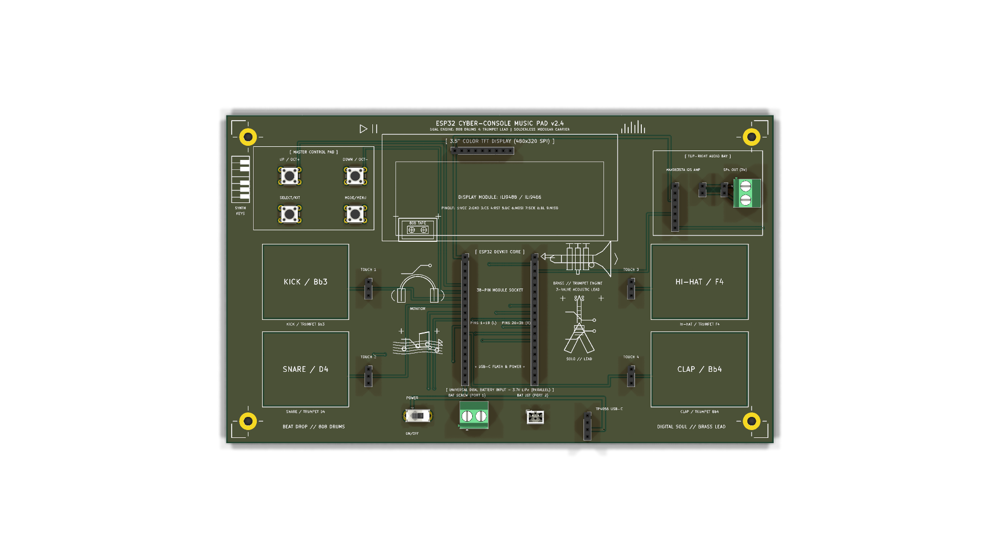
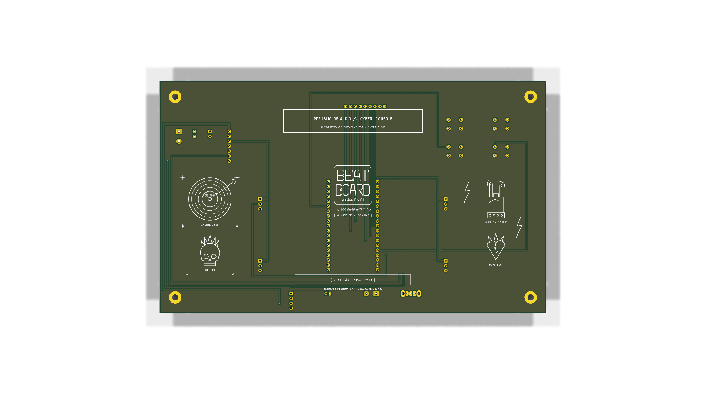
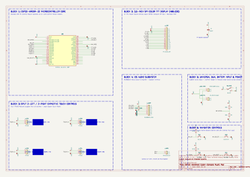

# BEAT BOARD

**BEAT BOARD** is a handheld music device and synthesizer that has a cyber-retro look and feel. It is built around the dual-core **ESP32** microcontroller. It has four gold-plated touch pads that are used for finger drumming and for playing brass lead notes. It also has a 3.5" color screen that shows an audio interface in real time. There is a $2 \times 2$ control pad for master control. There is also an onboard MAX98357A I2S Class-D amplifier that powers a speaker with a cavity design.

When the **MODE** button is pressed, a menu appears on the screen. This menu allows the user to switch between a **808 Drum Machine** that has a live 16-step sequencer and a **4-Valve Acoustic Trumpet Brass Synth** that has moving valve pistons and soundwave flares!

---

## Photos & Screenshots

### Top View (Silkscreen Doodles & Controls)

### Back View (ROG "BEAT BOARD" & Punk Doodles)

### Schematic
  
*Vector PDF available at [docs/images/schematic.pdf](docs/images/schematic.pdf)*

---

## How It Works

### How the parts fit on the console

I laid out every section of the carrier board to make the console as comfortable as possible for fast finger drumming and trumpet solos:

1. **Center Top (Display)**: A **3.5" Color TFT LCD module (480x320 SPI)** is raised at the center of the console. It shows audio waveforms, the 16-step drum sequencer grid, BPM tempo, battery status, and the interactive instrument selection menu.

2. **Center Core (Microcontroller)**: An **ESP32-WROOM-32 DevKit** microcontroller sits in female socket headers directly below the display. Its USB-C port faces downwards at the bottom edge, making firmware flashing and USB power convenient.

3. **Left Wing (Master Navigation & Drum Pads)**:
   - **Master Control Pad (Top Left)**: A $2 \times 2$ grid of tactile buttons (`UP`, `DOWN`, `SELECT`, `MODE`) lets your left thumb navigate menus, change kits, shift octaves, or mute the horn without lifting your hands.
   - **Left Touch Pads (Bottom Left)**: Two $24 \times 24\text{ mm}$ gold-plated capacitive touch pads (`PAD 1: KICK / Bb3` and `PAD 2: SNARE / D4`) are driven by two small red TTP223 daughterboards.

4. **Dedicated Top-Right Audio Bay**:
   - The **MAX98357A I2S 3W Class-D amplifier module** and green **KF301 2-pin speaker terminal block** are set in the isolated top-right corner.
   - Twisted red and black speaker wires leave cleanly from the top-right edge to a 3W cavity speaker, fully removed from your playing hands!

5. **Right Wing (100% Unobstructed Touch Controls)**:
   - The outermost elements on the right edge are `PAD 3: HI-HAT / F4` and `PAD 4: CLAP / Bb4`.
   - Your fingers and thumbs have unhindered access to the pads with zero obstacles or hurdles!

6. **Bottom Power Subsystem**:
   - Features a **TP4056 USB-C LiPo charger**, an aluminum **SPDT slide power switch**, a **JST-PH 2.0mm connector**, and a **KF301 screw terminal** for universal 3.7V LiPo battery packs.

---

## Bill of Materials (BOM)

| Item | Qty | Supplier | Cost / Item | Total Cost | Link |
| :--- | :---: | :--- | :---: | :---: | :--- |
| **ESP32-WROOM-32 DevKit V1 (38-Pin)** | 1 | Robu.in | $4.50 | $4.50 | [Robu.in](https://robu.in/product/esp32-development-board-ch340-38-pins/) |
| **3.5" SPI Color TFT LCD (480x320 ILI9488)** | 1 | Robu.in | $9.80 | $9.80 | [Robu.in](https://robu.in/product/3-5-inch-tft-lcd-screen-module-spi-interface/) |
| **MAX98357A I2S 3W Class-D Audio Amp** | 1 | Robu.in | $2.40 | $2.40 | [Robu.in](https://robu.in/product/max98357a-i2s-3w-class-d-amplifier-module/) |
| **4Ω 3W Mini Cavity Full-Range Speaker** | 1 | Robu.in | $1.20 | $1.20 | [Robu.in](https://robu.in/product/mini-stereo-speaker-4-ohm-3w/) |
| **TTP223 Capacitive Touch Sensor Modules** | 4 | Robu.in | $0.35 | $1.40 | [Robu.in](https://robu.in/product/ttp223-touch-key-switch-module/) |
| **6x6mm Tactile Push Buttons (SW1-SW4)** | 4 | Robu.in | $0.10 | $0.40 | [Robu.in](https://robu.in/product/6x6x5mm-tactile-push-button-switch/) |
| **TP4056 USB-C 1A LiPo Charging Module** | 1 | Robu.in | $0.65 | $0.65 | [Robu.in](https://robu.in/product/tp4056-type-c-usb-5v-1a-18650-lithium-battery-charger-module/) |
| **3.7V 1200mAh Rechargeable LiPo Battery** | 1 | Robu.in | $4.20 | $4.20 | [Robu.in](https://robu.in/product/3-7v-1200mah-lipo-battery/) |
| **SPDT Slide Switch (Power ON/OFF)** | 1 | Robu.in | $0.25 | $0.25 | [Robu.in](https://robu.in/product/ss12d00-spdt-slide-switch/) |
| **KF301-2P 5.08mm Screw Terminal Blocks** | 2 | Robu.in | $0.20 | $0.40 | [Robu.in](https://robu.in/product/2-pin-5-08mm-pitch-pcb-mount-screw-terminal-block/) |
| **JST-PH 2.0mm 2-Pin Male Connector** | 1 | Robu.in | $0.15 | $0.15 | [Robu.in](https://robu.in/product/jst-ph-2-0mm-2-pin-male-connector/) |
| **40-Pin 2.54mm Female Socket Headers** | 2 | Robu.in | $0.30 | $0.60 | [Robu.in](https://robu.in/product/40-pin-2-54mm-female-single-row-header-strip/) |
| **Custom BEAT BOARD PCB (200x120mm)** | 1 | JLCPCB | $1.90 | $1.90 | [JLCPCB](https://jlcpcb.com/) |
| **M3x12mm Brass Hex Standoffs & Screws** | 4 | Robu.in | $0.20 | $0.80 | [Robu.in](https://robu.in/product/m3-brass-hex-standoff-kit/) |
| **Estimated Shipping** | 1 | — | $3.00 | $3.00 | — |
| **Total Cost** | **26** | — | — | **$31.65** | — |

*Downloadable spreadsheet format is available at [BOM.csv](BOM.csv).*

---

## How to Build

1. **Solder the Low-Profile Components First**:
   - Insert and solder the four tactile push-buttons (`SW1`, `SW2`, `SW3`, `SW4`) in the Master Control Pad area.
   - Solder the SPDT slide power switch (`SW_PWR`) at the bottom edge.
2. **Solder Terminal Blocks & Connectors**:
   - Solder the two KF301 screw terminal blocks: `J_SPK` in the top-right audio bay and `J_BAT_TERM` in the bottom power bay.
   - Solder the 2-pin JST-PH battery header (`J_BAT_PIN`).
3. **Solder the Female Socket Headers**:
   - Cut and solder female socket header strips for:
     - `J_ESP_L` and `J_ESP_R` (two 19-pin rows for the ESP32 DevKit).
     - `J_TFT` (one 9-pin row for the TFT display module).
     - `J_AMP` (one 7-pin row for the MAX98357A amplifier).
     - `J_TP1` to `J_TP4` (four 3-pin rows for the TTP223 touch sensor boards).
     - `J_CHG` (one 4-pin row for the TP4056 charging module).
4. **Mount the M3 Brass Standoffs**:
   - Screw the four M3x12mm brass standoffs into corner mounting holes `H1`, `H2`, `H3`, and `H4` to form sturdy desk legs.
5. **Plug In the Modular Breakout Boards**:
   - Plug the ESP32 DevKit into its dual headers (USB-C port facing downwards).
   - Plug the 3.5" TFT LCD display into `J_TFT`.
   - Plug the MAX98357A amplifier into `J_AMP`.
   - Plug the four red TTP223 touch boards into `J_TP1` through `J_TP4`.
6. **Connect Speaker & Battery**:
   - Connect the red $(+)$ and black $(-)$ speaker wires to `J_SPK` and tighten the terminal screws.
   - Plug your 3.7V LiPo battery into `J_BAT_PIN` or `J_BAT_TERM`.
   - Slide `SW_PWR` to ON and start jamming!

---

## Software

The firmware supports both real hardware and the Wokwi online web simulator.

### Arduino IDE Upload Instructions
1. Open the Arduino IDE.
2. In **Tools > Board**, select **ESP32 Dev Module**.
3. In **Sketch > Include Library > Manage Libraries...**, install:
   - `Adafruit GFX Library`
   - `Adafruit ILI9341` (or `Adafruit_ILI9488`)
4. Open the firmware sketch:
   - **Multi-Engine Firmware**: [firmware/music_pad_wokwi.ino](firmware/music_pad_wokwi.ino)
   - **Dedicated Trumpet Synthesizer**: [firmware/standalone_trumpet_synth/standalone_trumpet_synth.ino](firmware/standalone_trumpet_synth/standalone_trumpet_synth.ino)
5. Select your COM port and hit **Upload**!

---

## KiCad & Production Files

All hardware design files are verified with KiCad 10.0 and have achieved a verified **0 DRC violation, 0 unconnected item** score:

- **KiCad Project File**: [kicad_project/music_pad.kicad_pro](kicad_project/music_pad.kicad_pro)
- **KiCad Schematic**: [kicad_project/music_pad.kicad_sch](kicad_project/music_pad.kicad_sch)
- **KiCad PCB Layout**: [kicad_project/music_pad.kicad_pcb](kicad_project/music_pad.kicad_pcb)
- **Fabrication Gerber Archive**: [gerbers.zip](gerbers.zip) *(Ready for JLCPCB, PCBWay)*
- **Bill of Materials Spreadsheet**: [BOM.csv](BOM.csv)
- **Engineering Journal**: [JOURNAL.md](JOURNAL.md)
